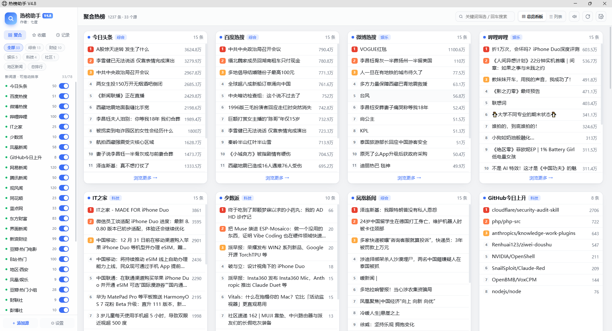
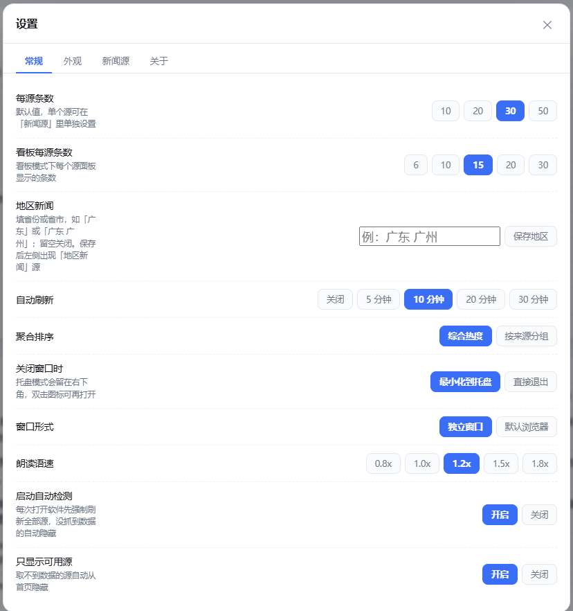
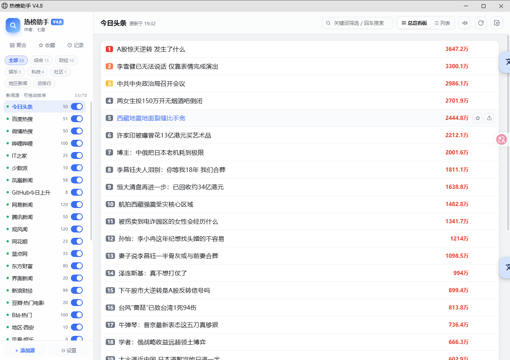

# 热榜助手 V4.8

一个聚合全网热榜的 Windows 桌面小工具，让你在一个窗口里刷遍各大平台的热搜榜单。
作者：**七度** ｜ 免费 · 无广告 · 不需要登录任何账号

**网页版 / 安卓版（浏览器直接打开，可添加到手机主屏幕）**：
👉 https://hotboard-mobile.app.workbuddy.host/?sharecode=5FPPVW7FTM

---

## ✨ 功能特性

### 📰 热榜聚合
- **70+ 热榜源**：今日头条、微博、知乎、B站、抖音、百度、腾讯新闻、IT之家、虎扑、豆瓣、36氪、吾爱破解、GitHub 上升榜、财联社、东方财富、新浪财经、上交所、国务院文件、ModelScope 模型榜、卫星通讯社等，一次看全
- **五大分类**：综合 / 财经 / 娱乐 / 科技 / 社区，分类一键切换
- **地区新闻**：设置自己的省 / 市，随时看本地新闻榜
- **总排行**：全部新闻源按阅读 / 评论 / 热度合并大排行
- **多线程抓取**：所有源并发加载，速度快；启动时没抓到数据的源自动隐藏，并可一键恢复
- **每个源独立设置**：显示条数 1~50 任意整数、可改抓取地址、可增删源、可拖动排序

### 🖥️ 两种视图
- **总览看板**：所有源拼成一屏看板，单行 4 列、板块等大，标题两行完整显示，鼠标悬停显示全题；板块底部「浏览更多」直达单源全部新闻
- **紧凑列表**：排名 + 标题 + 热度，一行一条，适合快速刷榜
- **打开默认进入聚合热榜总览看板**，视图切换即时生效

### 🔍 阅读体验
- **关键词搜索**：输入即筛，看板 / 列表 / 单源 / 收藏 / 浏览记录全部实时过滤
- **语音朗读**：连续朗读本页标题，读完自动停止，语速可调、中途调速不打断
- **收藏夹 & 浏览记录**：喜欢的新闻一键收藏
- **字号 / 字体调节真正生效**：标题、热度、榜单全部跟随缩放
- **主题自定义**：深色 / 浅色模式、7 种主题配色（按钮高亮 + 排名徽标联动变色）、自定义字体、背景图 + 浓度调节（背景可透进新闻框）

### ⚙️ 其他
- **单实例运行**：重复双击不会多开，自动唤起已有窗口
- **关闭最小化到托盘**：右下角常驻，双击图标随时打开
- **绿色免安装**：单文件 exe，双击即用
- **升级自动补新源**：老版本升级后自动追加新增的新闻源，原有设置全部保留
- **网页版同款体验**：手机浏览器打开网页版，收藏云端同步

## 📝 更新日志

### V4.8
- 去掉顶栏「翻译本页」按键
- 启动时「有源没抓到数据」的通知条 3 秒后自动关闭
- 修复：总览看板模式下关键词搜索不生效的问题（现在全视图实时筛选）

### V4.7
- 修复朗读只读第一条、不连读的 bug
- 总览看板面板高度调整为 480px
- 上传背景图后新闻框半透明，透明度跟随「背景浓度」
- 分类按钮去掉图标；打开软件默认显示聚合热榜总览看板

### V4.5 ~ V4.6
- 看板面板加高、板块间隙加大、标题两行全显、单行固定 4 列
- 修复字号调节、主题配色、每源条数不生效的多个设置 bug
- 修复配置升级合并可能产生重复源的问题

### V4.2 ~ V4.4
- 财经板块新增：财联社、东方财富、新浪财经、国务院文件、上交所、淘股吧、彭博社、ModelScope 模型榜、卫星通讯社·中国
- 总览看板：板块大小固定、内部滚动、底部「浏览更多」、悬停显示完整标题

### V3.2 ~ V4.1
- 新增看板 / 列表双视图、五大分类导航、总排行、地区新闻
- 多线程并发抓取、失效源自动隐藏
- 修复新闻标题中「多少亿」被误判为阅读量的 bug

### V3.1
- 首个发布版本：40+ 热榜聚合、收藏、朗读、主题自定义、单实例、托盘

## 🔒 安全性说明（请放心使用）

- **代码 100% 原创**：全部代码由作者独立编写，无任何第三方来路不明代码
- **不联网上传任何数据**：软件只在本地运行，抓取各网站公开榜单页面缓存到本机；没有账号系统、没有数据上报、没有埋点统计
- **不收集个人信息**：不申请任何权限，不读取你的文件、浏览记录
- **图标为自行生成**，Python 官方标准库与 PyInstaller 打包工具均允许免费再分发
- **绿色免安装**：单文件 exe，双击即用，配置保存在本机 `%APPDATA%` 目录
- 可以自行查看源码，抓取逻辑透明公开

## 📥 下载使用

1. 在本仓库下载 `热榜助手V4.8.exe`
2. 双击运行即可（Windows 10/11）
3. 如被杀毒软件提示（未签名的免费小软件常见情况），添加信任即可，软件无任何恶意行为
4. 老版本用户直接运行新版即可，配置和收藏自动保留

## 📱 网页版（安卓 / iOS 通用）

作者暂未做出独立安卓 App，先提供网页版，手机浏览器打开即可使用，功能与桌面版一致：
https://hotboard-mobile.app.workbuddy.host/?sharecode=5FPPVW7FTM
建议用浏览器"添加到主屏幕"，体验接近原生 App。

## 💬 联系作者

- 如有**侵权问题**，请联系作者微信：**460275097**，会第一时间处理
- 想加新站点、报 BUG、用着不顺手，也欢迎添加交流
- 觉得好用的话，软件里有个请喝咖啡的入口 ☕

## 📄 许可

供个人免费使用，请勿用于商业用途或二次打包牟利。
