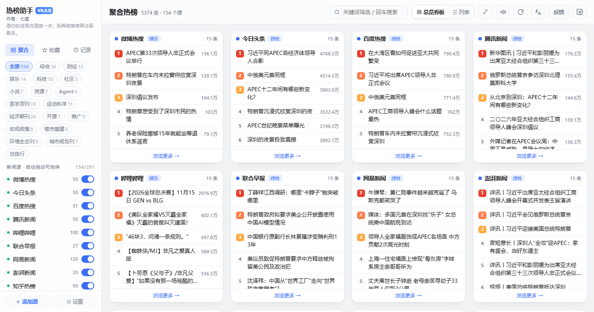
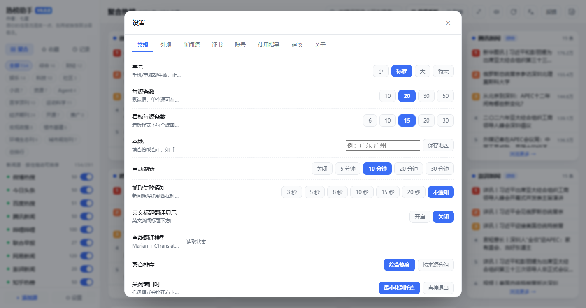
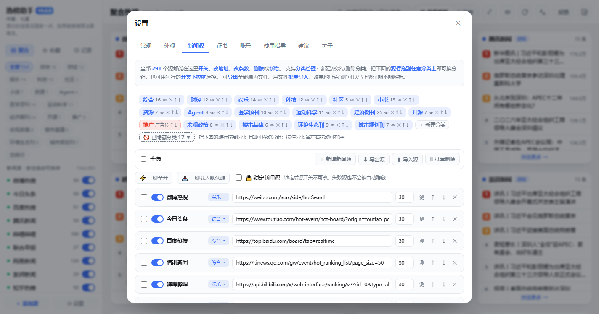

# 热榜助手 V8.0.7

一个聚合全网热榜的工具，让你在一个窗口里刷遍各大平台的热搜榜单。
愿你的信息流清爽一点，别再被推荐算法牵着走。电脑端、安卓端、网页端三端通用，功能一致。

作者：**七度** ｜ 免费 · 无广告 · 不登录也能用（登录仅用于收藏云端同步，可选）

**在线体验（网页版，手机浏览器直接打开，可添加到主屏幕）**
👉 https://rebang-web.app.workbuddy.host/?sharecode=2SURQEZFNL

**安卓 App**：在下方 [Releases 发布页](https://github.com/460275097/rebang-helper/releases) 下载 `rebang-helper-V8.0.7.apk` 安装，与电脑端功能一致

**网盘下载（备用通道，exe + apk 都在里面）**
- 百度网盘：https://pan.baidu.com/s/5EsBVle520XFowOUkqzsiyg
- 夸克网盘：https://pan.quark.cn/s/d3a6b17b96b1

**最新版统一发布页**：https://github.com/460275097/rebang-helper/releases



---

## ✨ 功能特性

### 📰 热榜聚合
- **292 个内置热榜源**：今日头条、微博、知乎、B站、抖音、百度、腾讯新闻、IT之家、虎扑、豆瓣、36氪、吾爱破解（精品软件区·Android）、GitHub 今日上升、财联社、东方财富、新浪财经、上交所、国务院文件、中国人民银行、财政部、国资委、财新、央视新闻、国家统计局、中房网、现代城市研究、规划师、素材资源、ModelScope 模型榜、卫星通讯社、医学顶刊、各学科期刊、开源项目等，一次看全
- **34 个分类**：综合 / 财经 / 娱乐 / 科技 / 社区 / 小说 / 资源 / Agent / 医学顶刊 / 运动科学 / 经济期刊 / 开源 / 推广 / 宏观政策 / 楼市基建 / 环境生态刊 / 城市规划刊 等 17 个默认显示；另外 17 个学科类（材料科学刊、公共卫生刊、神经科学刊、物理天文刊…）**首次打开自动隐藏**，需要时在「设置 → 新闻源 → 🚫 已隐藏分类」里一键恢复
- **一个源可以属于多个分类**（最多 4 个）：例如「GitHub 今日上升」同时出现在「开源」和「资源」里；分类改名、删除、隐藏、计数、导入导出全部按多分类处理
- **分类可自建、改名、删除、隐藏、拖拽排序**：「推广」分类锁定为广告位（不可删不可隐藏，只能排序）；「本地」分类不设置地区时自动不显示
- **本地新闻**：设置自己的省 / 市，随时看本地新闻榜
- **总排行**：全部新闻源合并大排行，每个源只取前 3 条，避免单一站点刷屏
- **接口优先**：能走官方 JSON 接口的源绝不爬页面（微博、B站、知乎、抖音、虎扑、头条、财联社等），抗改版、速度快、更稳定；接口失效自动降级到备用通道
- **多线程并发 + 缓存秒开**：热缓存 0.1 秒打开；只抓「可见分类」里开启的源，默认 160 个左右，冷启动几秒完成；没抓到数据的源保留上次内容并提示，不再白屏
- **每个源独立设置**：显示条数 1–50 任意整数、可改抓取地址、可增删源、可拖动排序

### 🖥️ 两种视图
- **总览看板**：所有源拼成一屏看板，列数 1–12、行数 1–6 可调（默认 4 列 2 行），右侧/底部拖拽条直接拖动改，顶栏「⤢ 自适应」一键铺满；标题两行完整显示，悬停看全题；板块底部「浏览更多」直达单源全部新闻
- **紧凑列表**：排名 + 标题 + 热度，一行一条，适合快速刷榜
- **手机浏览器自动切移动版**：顶栏变汉堡抽屉 + 图标化按钮，看板强制单列，不再横向溢出（安卓 App 走原生壳排版，不受影响）

### 🔍 阅读体验
- **关键词搜索**：输入即筛，看板 / 列表 / 单源 / 收藏 / 浏览记录全部实时过滤
- **一键翻译本页**：整页标题中英对照，自动分批补齐不漏条；引擎可选「自动 / 仅在线 / 仅离线」，桌面端支持谷歌、百度、有道（后两者需自备 Key，未配自动降级），离线可用 Marian / 安卓 ML Kit
- **语音朗读（三重引擎）**：看板模式逐源连读（每源 10 条、播报源名、序号自动计数）；引擎自动切换：桌面走系统语音 / 在线神经网络语音，安卓走原生 TTS / 云端在线语音，没装语音库也能出声；语速可调（默认 1.25 倍），中途调速不打断
- **收藏夹 & 浏览记录**：喜欢的新闻一键收藏，登录后云端同步
- **字号 / 字体调节真正生效**：14 款常用字体 + 自定义字体，标题、热度、榜单全部跟随缩放
- **主题自定义**：深色 / 浅色模式、7 种主题配色（默认经典红）、背景图片 + 透明度 0~100%

### ⚙️ 其他
- **主界面独立窗口**：桌面端默认开一个没有地址栏的独立窗口（Edge / Chrome 的 `--app` 模式 + 专用配置目录），不会并进已打开的浏览器标签，也不会莫名退回浏览器模式
- **外链用你自己的浏览器打开**：点击新闻跳转时默认使用「带插件书签的日常浏览器」，扩展、翻译插件全都能用；可在设置里改 系统默认 / Edge / Chrome / 自定义浏览器 exe，带一键检测
- **单实例运行**：连点多次不会多开，新版本启动自动关闭旧版本，重复打开时聚焦已有窗口
- **新闻源管理**：顶部工具条「＋ 新增新闻源 / ⬇ 导出源 / ⬆ 导入源 / 🗑 批量删除」，一键全开、一键载入默认源、锁定新闻源、单条测速，勾选批量删除，导出 / 导入 JSON 备份恢复
- **设置页签常显**：常规 / 外观 / 新闻源 / 证书 / 账号 等页签固定在顶部，内容再长也顶不掉，只有内容区滚动
- **失败源明细**：抓不到数据的源会提示，点「查看详情」看是哪些源失败、为什么失败，可单源重试或隐藏
- **关闭最小化到托盘**：右下角常驻，双击图标随时打开
- **题目缓存（AI 可分析）**：每天自动把抓到的题目存成本机 JSONL 文件（一天一个文件夹），设置里可改目录、一键复制路径、打开目录；文件夹里附带 `README-AI.txt`，把整个目录交给 AI 助手就能做每日推送、趋势分析、标的关联等二次加工
- **侧边栏管理更顺手**：侧边栏每个源行带「校」校准按钮、点击源行立即置顶；隐藏的分类不再占地方，侧边栏「🚫 已隐藏分类」入口可随时恢复显示或彻底删除
- **绿色免安装**：单文件 exe，双击即用；配置存在本机 `%APPDATA%\热榜助手V2`
- **升级自动补新源**：老版本升级后自动追加新分类、新源，原有设置、收藏、排序全部保留
- **网页版每个访客独立配置**：置顶、隐藏、分类、外观存在自己设备上，互不影响




## 🤖 题目缓存 × AI 智能体分析

从 V8.0.5 起，软件每天自动把抓到的标题存成本机文件。这些文件是开放格式，可以直接丢给 AI 智能体（如 WorkBuddy、其他 AI 助手）读取，用来做**每日热点推送、趋势分析、经济形势跟踪、股票标的关联**等任务。

### 第一步：复制缓存路径给 AI

1. 打开软件 → **设置 → 「题目缓存」**
2. 点 **「📋 复制路径」** 按钮，缓存目录地址就复制到剪贴板了（也可以点「📂 打开目录」自己看一眼，目录不存在时会自动创建）
3. 把这句话发给你的 AI 智能体：

```
这是热榜助手本机的题目缓存目录：
C:\Users\你的用户名\AppData\Roaming\热榜助手V2\titles
请读取里面的 JSONL 文件，帮我……（按需填：每天汇总推送 / 分析经济形势 / 跟踪我关注的公司）
```

> 想换个更好找的位置？在同一区块把目录改成 `D:\热榜缓存` 之类的自定义路径，点「保存」即可，旧数据会自动迁移追踪。

### 第二步：AI 会看到什么

```
titles/
├── README-AI.txt        ← 数据格式说明，AI 读到它就自己知道字段怎么用
├── 2026-11-19/
│   ├── 财经.jsonl        ← 每天一个文件夹，按分类分文件
│   ├── 综合.jsonl
│   └── _all.jsonl        ← 当天全部分类合并流，一次读一天
└── 2026-11-20/
    ├── 财经.jsonl
    └── _all.jsonl
```

每行一条独立的 JSON 对象（JSONL，可按行流式解析）：

```json
{"ts": "2026-11-20 09:31:05", "cat": "财经", "src": "华尔街见闻", "title": "……", "url": "https://……", "heat": 9865}
```

| 字段 | 含义 |
| --- | --- |
| `ts` | 抓取时间 |
| `cat` | 新闻源所属分类（多分类用 / 连接） |
| `src` | 新闻源名称 |
| `title` | 标题（最长 160 字） |
| `url` | 原文链接（同一天内唯一，可做去重主键） |
| `heat` | 热度数值（可能为 null） |

### 可以让 AI 建立的自动化任务举例

- **每日热点推送**：每天早上让 AI 读昨天的 `_all.jsonl`，去重后汇总 Top 20 热点，推送到微信 / 邮件
- **经济形势跟踪**：只读「财经 / 宏观政策」等分类文件，统计关键词频率变化，生成每日简报
- **标的关联提醒**：维护一张关注词表（公司名 / 股票简称），AI 每天扫描 `title` 命中情况，命中就提醒你
- **趋势复盘**：按日期顺序读多天，统计某个话题的出现频率曲线

> 提醒：标题是二手信号，AI 的分析结论适合做研究线索参考，不构成投资建议。

---

## 📝 更新日志

### V8.0.7（当前版本）
- **主窗口默认恢复独立窗口**：上一版曾默认跳浏览器，现改回独立窗口；「用哪个浏览器打开外链」只管点新闻时的跳转

### V8.0.6
- **EXE 外链默认用「带插件书签的日常浏览器」打开**：不再是没有插件的隔离窗口，书签、翻译插件全都在；设置里可切换 系统默认 / Edge / Chrome / 自定义浏览器 exe，带「检测」按钮
- **侧边栏新增「🚫 已隐藏分类」入口**：点开能看到哪些分类被隐藏了，可恢复显示或连源一起删除
- 手机端横版顶栏同样能查看 / 恢复已隐藏分类
- **修复校准「网络错误」「解析失败」提示**：抓取增加四级重试阶梯（免证书 → 手机 UA → 降级 HTTP），失败原因用人话说明
- 题目缓存「打开目录」不再自动弹出资源管理器；缓存目录可以直接手改，也可浏览选择
- 移除「站点 Cookie（高级）」设置项（界面精简）

### V8.0.5
- **新增「题目缓存」**：每天自动把抓到的题目存成本机 JSONL（一天一个文件夹），设置里可改目录、一键复制路径、打开目录；文件夹里带 `README-AI.txt`，交给 AI 助手即可做每日推送、趋势分析
- 已隐藏 / 计数为 0 的分类不再占侧边栏位置
- 侧边栏每个源行新增「校」校准按钮；点击源行立即置顶
- 使用指导补充「校准向导」「题目缓存」说明
- GitHub 今日上升地址核对为 `github.com/trending?since=daily`

### V8.0.4
- **版本号统一**：标题 / 关于页 / 侧栏徽标 / exe 文件属性全部从同一处读取，不再出现「打开还是上一代版本」
- **EXE 启动稳定性加固**：单实例唤醒失败自动强开窗口；窗口打开方案五级兜底；重复打开只聚焦当前版本的窗口；异常写「崩溃日志.txt」
- 看板卡片右上角新增「✎ 修改 / ⋯ 更多」快捷入口
- 设置 → 新闻源列表支持即时搜索过滤（不掉焦点、Esc 清空）
- 校准向导里改过的抓取地址会写回源配置
- 安卓 WebView 加缓存破坏参数，杜绝旧页面

### V8.0.3
- **新闻源识别引擎重做**：导航 / 页脚 / 侧栏结构排除 + 分组签名 + 组级评分，修掉一批「把导航栏当新闻标题」的站点；宁可报错也不出假数据
- **新增校准向导**：任意源一键校准 —— 列出候选解析方案、逐个预览、保存锁定，实测即所得；源行加「校」按钮，新增源对话框带「校准」入口
- 源内检索校准：搜索地址含 `{q}` 时自动校准结果页，软件内直接看检索结果
- 修复 15 个失效源（期刊类换 Crossref / arXiv / RSS 通道），禁用 10 个死站
- 移动端校准向导底部弹出，设置弹窗适配小屏不横向溢出

### V8.0.2
- 「＋ 新增新闻源」从列表底部移到顶部工具条，排在「导出源 / 导入源」前面
- **修复设置页签被内容顶掉**：常规 / 外观 / 新闻源 / 证书 / 账号 等页签原来会被超长列表挤到看不见（只能关掉重开）。现在标题栏与页签栏固定、只有内容区滚动，实测新闻源列表滚到最底、1000×620 小窗口下页签依然常显
- **桌面端独立窗口加固**：改用 Edge / Chrome 的 `--app` 模式 + 专用配置目录（不会再并进已打开的浏览器标签），并增加注册表路径探测；只有完全找不到浏览器才退回默认浏览器，并写日志
- **修掉「窗口偶尔变成默认浏览器模式」的根因**：窗口形式不再参与云端同步，换端登录不会被别端的设置改掉；「默认浏览器」按钮旁加提示「方便用浏览器扩展插件翻译」
- **一个新闻源可以属于多个分类**（最多 4 个）：源行分类改成按钮 + 勾选浮层，拖到分类页签 / 分类块＝加入该分类；隐藏分类只有在某个源的所有分类都被隐藏时才关闭该源
- GitHub 今日上升：同时归入「开源」+「资源」
- 国家统计局：改抓「数据发布」栏目（`stats.gov.cn/sj/zxfb/`），专用解析器，标题带日期
- 吾爱破解：改抓「软件安全 › 精品软件区 › [Android]」，专用解析器，保持发帖顺序
- 新增源「素材资源」（`sucaizy.com` 最新发布栏），归入「资源」分类
- SocialPeta Google Play 榜分类：科技 → 财经
- 删除源：微线报、Apifox API 中心、虎嗅、GoodNovel、Property Week（老配置升级时自动清理）

### V8.0.1
- 修复「17 个默认隐藏分类又冒回侧边栏」：本机旧配置副本会整体覆盖服务端设置，把隐藏清单冲空。改为三层兜底（前端合并「服务端 hideCats ∪ 本机 − 手动恢复」、`hiddenCats()` 硬兜底、后端 update 兜底），老用户升级后也不会再冒出来

### V8.0.0
- **七个源换专用解析器**，不再靠通用规则猜：中国人民银行（新闻发布）、财政部（政策发布）、财新（经济频道）、央视新闻（经济频道）、中房网、现代城市研究（土地与房地产）、规划师（最新一期目录导读）
- 国资委新闻源迁入「宏观政策」；「产业赛道」整类下线（分类 + 旗下源一并移除）
- 删除「The BMJ 英国医学杂志」
- 「推广」分类锁定：不可删除、不可隐藏，只能调整排序（标记为广告位）
- 「本地」分类：不设置地区时自动不显示，可隐藏、可删除
- **首次打开自动隐藏 17 个新分类**（材料科学刊、公共卫生刊等），「已隐藏分类 N」面板可随时恢复
- 桌面端 / 网页版首次打开默认值：看板 4 列 2 行、英文翻译关闭、每源 20 条、看板每源 15 条、抓取失败通知关闭、只显示可用源开启、启动自动检测开启、经典红配色（安卓 App 保持原有默认，不受影响）
- 总排行每个源只取前 3 条
- **流畅度优化**：看板 / 列表启用 `content-visibility` 离屏跳过排版、看板改事件委托、分批抓取的重渲染用 `requestAnimationFrame` 合并 —— 看板全量渲染 315ms → 50ms，布局 54ms → 1.4ms
- 版本号跳过 7.9.14，直接 8.0.0

### V7.9.13
- 设置 → 新闻源新增「🚫 已隐藏分类 N」专区：每条可「👁 恢复显示」或「🗑 删除」（连同只属于它的源一起删）
- 清理 46 个失效源：10 个换通道救回（OpenAI 改 RSS、BJSM / ChemRxiv 走 Crossref、国资委 / 规划师 / 现代城市研究等改直连），其余 36 个删除
- **旧页面自愈**：页面版本与服务端不一致时自动强刷一次，解决安卓 WebView 缓存旧页面

### V7.9.12
- 精简分类与源：删 5 个分类、73 个实测抓不到列表的源
- 15 个新分类默认隐藏，并且**只抓可见分类的源** —— 默认要抓的源从 411 降到 198，冷启动明显变快
- 顶栏图标统一为纯图标 + 中文悬停说明

### V7.9.11
- 新增 27 个分类、268 个源（宏观政策、前沿 AI、楼市基建、能源电力、学术顶刊、各学科期刊等），期刊类统一走 Crossref 按 ISSN 取最新论文

### V7.9.10
- 删 34 个失效源；「医疗期刊」分类随之清空并下线
- 修「分类删不干净」：整类下线改成加载 / 保存 / 云端恢复全链路强制过滤，缓存页面或云同步都塞不回来

### V7.9.9
- 「国际新闻」「币圈」两个分类整类下线（含 29 个源），再删 10 个失效源

### V7.9.8
- 看板列数 1–12、行数 1–6 可调，拖边缘也能改，「⤢ 自适应」一键铺满
- 总排行每源只取前 3；新默认值（每源 20 条 / 看板 15 条 / 4 列 2 行 / 失败通知关）
- 下线 6 个失效源；新闻源默认顺序重排（微博、头条、百度、腾讯、B站…在前）
- exe 换用与安卓端同源的图标

### V7.9.7
- 看板可拖拽调列数 / 行数，卡片高度自适应
- 翻译新增「模型：自动 / 仅在线 / 仅离线」与离线模型选择（Marian / 安卓 ML Kit）
- 安卓离线翻译修复（ML Kit 资源类缺失导致初始化崩溃）

### V7.8
- 失败提示条新增「查看详情」：列出全部失败源及失败原因，可单源重试 / 隐藏
- 设置 → 新闻源 → 分类管理：每个分类新增 ↑ ↓ 按钮，可调整分类在导航栏的顺序
- 修复拖拽分类页签时松手落在页签间隙导致排序失效的问题

### V7.7
- 修复分类页签拖拽「改了顺序没生效」的位置偏差问题（从前往后拖不再落错位置）
- 新增单窗口守卫：重复双击图标不再叠出第二个窗口，自动聚焦已有窗口

### V7.6
- 修复新闻源列表拖动排序不生效的问题（拖到目标行上半部 / 下半部决定插入位置，行间松手不再作废）

### V7.5
- **域名级限速**：同一站点两次请求间隔 0.6 秒，避免被目标站限流
- **备用通道降级**：重要源配置备用地址，主地址失败自动切换（如豆瓣电影周榜走 RSSHub）
- **抓取结果定时落盘**：重启不丢数据
- **站点 Cookie（高级）**：设置 → 常规，可给需要登录的站点配置 Cookie

### V7.4
- 36 氪改抓官方快讯页；新增百度热搜、B 站热门；微信读书因需登录态默认关闭

### V7.3
- 启动新版本时自动关闭旧版本，不再出现「双击新版却打开旧版」
- 分类页签拖拽新增「删除该分类」投放框
- 下架失效源：什么值得买、雪球、财联社（旧源）、爱奇艺、小米有品、360 热搜

### V7.2
- 修复反馈面板「云端未连接」问题，显示真实失败原因并自动重试
- 「隐藏 / 删除」投放区改为左右分列，必须拖进框内才生效
- 一键翻译本页改为分批循环补齐，不再漏条，并显示进度
- 反馈图标改为文字「反馈」

### V7.0 ~ V7.1
- 新增「一键翻译本页」（整页标题中英对照）
- 猫眼票房改抓「正在热映」，新增淘票票、BoxOfficeMojo；SourceForge 官方博客失效 → 换 GitHub Blog / LWN / Phoronix
- 新增分类：医学顶刊 / 医疗期刊 / 运动科学 / 经济期刊 / 开源（Crossref、PubMed、Gitea 接口）
- 分类页签可拖拽排序，拖到红色投放区可隐藏分类
- 点击分类页签立即切换到该分类的总览看板
- 侧栏新闻源拖动可排序，向下拖出现「隐藏 / 删除」投放区
- GitHub 条目自动附中文简介

### V6.2 ~ V6.6
- **分类管理**：新建 / 改名 / 删除分类，每条源下拉框决定归属，源行可直接拖到分类上换组
- 新增分类：国际新闻（22 源）、小说（25 源）、币圈（7 源）、资源（吾爱破解 / GitHub / 大眼 / 异次元 / cr173 / 白菜哦 / 果核）、Agent
- 选择器引擎支持 `*=` `^=` `$=` `|=` 匹配；移除已停运的 Kindle Vella、XinXii
- **性能大优化**：缓存秒开、限时转后台、并发 24 线程、定时预取，上百源冷启动 7 秒内完成
- 内置奥斯卡静态榜单

### V6.0 ~ V6.1
- 安卓 App 朗读修复 + 双保险：原生语音不可用时自动切换**云端在线神经网络语音**（不依赖手机语音引擎，联网即有声音）
- 后端新增跨平台在线语音合成接口（微软晓晓音色，带缓存），桌面端同样受益
- 新增国际新闻、小说分类，20+ 新新闻源；猫眼票房接入；书旗 / 微信读书 / 起点改为七猫 / 纵横

### V5.0 ~ V5.5
- **朗读重做**：改为后端直接调用 Windows 系统语音 + 微软在线语音，修复桌面壳内「进度条会动但没声音」
- **看板模式朗读**：逐源连读、每源 10 条、播报源名、序号每源重新计数，读完自动接下一个源
- 默认读速 1.25 倍；看板卡片固定宽度不压缩，小窗口横向滚动
- 安卓壳升级：边缘滑动返回、点击新闻跳系统浏览器、原生 TTS 桥、文件选择器、二维码长按保存、系统分享面板
- 新闻源设置：一键全开、锁定新闻源、一键载入默认源、导出 / 导入
- **单实例改用 Windows 命名互斥体**：快速连点 exe 也不会多开
- 背景透明度 0~100%、顶栏同步透出背景图；字号档位加大

### V4.5 ~ V4.9
- 看板面板加高、板块间隙加大、标题两行全显、单行固定 4 列；修复字号 / 主题 / 每源条数不生效等多个设置 bug
- 新增地区新闻、总览看板每源条数设置项；修复搜索筛选时空态提示文案、地区新闻设置无法保存
- 去掉顶栏「翻译本页」按键；启动时「有源没抓到数据」的通知条 3 秒后自动关闭
- 修复朗读只读第一条、不连读的 bug；上传背景图后新闻框半透明

### V3.1 ~ V4.4
- 首个发布版本：40+ 热榜聚合、收藏、朗读、主题自定义、单实例、托盘
- 新增看板 / 列表双视图、分类导航、总排行、地区新闻；多线程并发抓取、失效源自动隐藏
- 财经板块新增：财联社、东方财富、新浪财经、国务院文件、上交所、淘股吧、彭博社、ModelScope 模型榜、卫星通讯社·中国

> 自 V7.9 起，桌面端、安卓端、网页版共用同一套版本号与同一份代码，不再单独编号（旧的 M5.x 手机端记录合并进对应版本）。

## 🧩 源码说明

| 文件 | 作用 |
| --- | --- |
| `app2.py` | 单文件后端（Python 标准库 `http.server`）+ 全部抓取解析器 + 配置迁移 |
| `ui2.html` | 前端整站（HTML/CSS/JS 一体，无框架、无外链） |
| `ui_embed.py` | 由 `ui2.html` 压缩生成的内嵌页面（**改完 html 必须重新生成**） |
| `build_all.py` | 一键打包 exe（自动重生成 `ui_embed.py` → PyInstaller 单文件，版本号取自 `VERSION`） |
| `build_apk.py` | 一键打包安卓壳 APK |
| `bump.py` | 一键升版本号（`ui.html` / `version_info.txt` / APK / WebView 参数） |
| `version_info.txt` | exe 文件属性（产品版本等） |
| `ic_launcher.ico` | 程序图标（与安卓端同源，16~256 多尺寸） |
| `VERSION` | 当前版本号 |

```bash
# 本地跑起来（需要 Python 3.10+，只用标准库）
python app2.py

# 打包 exe（需要 pip install pyinstaller）
python build_all.py
```

安卓端是 WebView 壳（原生 TTS、文件选择、分享面板、边缘返回都在壳里），界面复用同一份 `ui2.html`，因此三端永远同步。

## 🔒 安全性说明（请放心使用）

- **代码 100% 原创**：全部代码由作者独立编写，无任何第三方来路不明代码
- **不采集个人数据**：没有埋点、没有统计上报；抓取的都是各网站公开榜单，缓存只存在本机
- **账号是可选的**：不登录也能用全部功能，登录只用于收藏 / 配置云端同步；不登录时软件完全离线可用
- **只在本机运行**：网页版也是你自己打开浏览器访问，配置存在浏览器或本机 `%APPDATA%` 目录
- **图标自行生成**，Python 标准库与 PyInstaller 均允许免费再分发
- 源码全部公开，抓取逻辑透明，可自行核对

## 📥 下载使用

**电脑版（Windows 10 / 11）**
1. 到 [Releases 发布页](https://github.com/460275097/rebang-helper/releases) 下载 `rebang-helper-V8.0.7.exe`（约 31 MB），或从上面的网盘链接下载
2. 双击运行即可，绿色免安装
3. 如被杀毒软件提示（未签名的免费小软件常见情况），添加信任即可，软件无任何恶意行为
4. 老版本用户直接运行新版，配置和收藏自动保留（新版启动会自动关闭正在运行的旧版）

**安卓版**
1. 到 Releases 发布页下载 `rebang-helper-V8.0.7.apk`（约 21 MB，版本 8.0.7 / versionCode 80007），或从网盘下载
2. 安装时如提示「未知来源应用」，允许一次即可
3. 与电脑端功能一致，收藏可云端同步

## 📱 网页版（安卓 / iOS 通用）

不想装 App 也可以直接用网页版，手机浏览器打开即可，功能与桌面版一致：

https://rebang-web.app.workbuddy.host/?sharecode=2SURQEZFNL

建议用浏览器「添加到主屏幕」，体验接近原生 App。旧的 `hotboard-mobile` 地址已停用，请用上面这个新地址。

## 💬 联系作者

- 如有**侵权问题**，请联系作者微信：**460275097**，会第一时间处理
- 想加新站点、报 BUG、用着不顺手，也欢迎添加交流
- 觉得好用的话，软件里有个请喝咖啡的入口 ☕

## 📄 许可

供个人免费使用，请勿用于商业用途或二次打包牟利。
