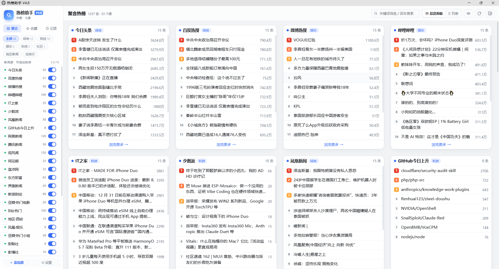
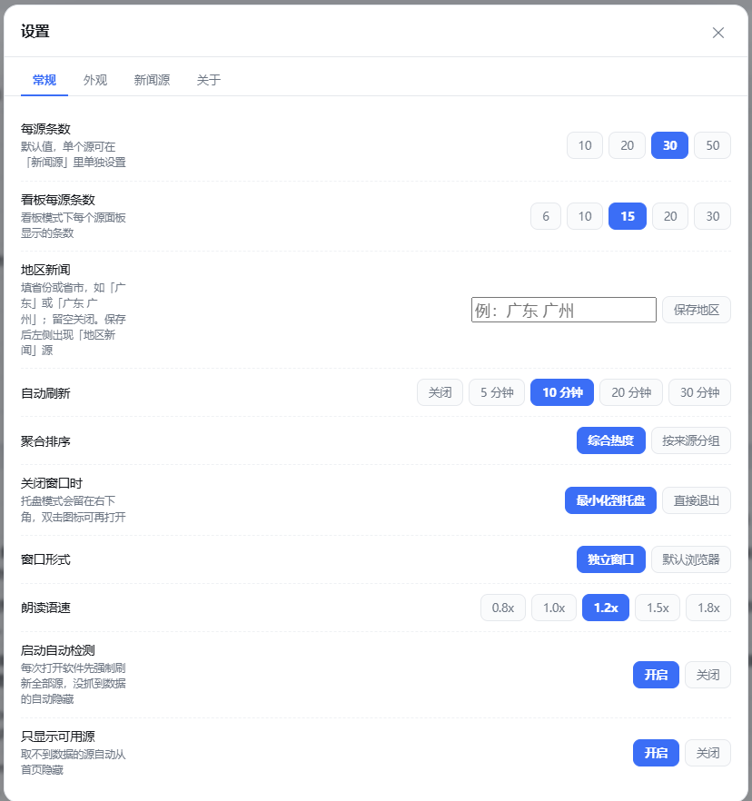

# 热榜助手 V7.8

一个聚合全网热榜的工具，让你在一个窗口里刷遍各大平台的热搜榜单。
愿你的信息流清爽一点，别再被推荐算法牵着走。电脑端，手机端，网页端均通用。
作者：**七度** ｜ 免费 · 无广告 · 不需要登录任何账号

**在线体验（网页版，手机浏览器直接打开，可添加到主屏幕）**：
👉 hotboard-mobile.app.workbuddy.host?sharecode=5FPPVW7FTM

**安卓 App**：下载本仓库的 `热榜助手.apk` 安装，与电脑端功能一致

---

## ✨ 功能特性

### 📰 热榜聚合
- **200+ 热榜源**：今日头条、微博、知乎、B站、抖音、百度、腾讯新闻、IT之家、虎扑、豆瓣、36氪、吾爱破解、GitHub 上升榜、财联社、东方财富、新浪财经、上交所、国务院文件、ModelScope 模型榜、卫星通讯社、医学顶刊、医疗期刊、运动科学、经济期刊、开源项目等，一次看全
- **15 大分类**：综合 / 财经 / 娱乐 / 科技 / 社区 / 国际新闻 / 小说 / 币圈 / 资源 / Agent / 医学顶刊 / 医疗期刊 / 运动科学 / 经济期刊 / 开源，分类可自建、改名、删除、隐藏、拖拽排序
- **本地新闻**：设置自己的省 / 市，随时看本地新闻榜
- **总排行**：全部新闻源按阅读 / 评论 / 热度合并大排行
- **接口优先**：能走官方 JSON 接口的源绝不爬页面（微博、B站、知乎、抖音、虎扑、头条、财联社等），抗改版、速度快、更稳定；接口失效自动降级到备用通道
- **多线程并发抓取 + 缓存秒开**：热缓存 0.1 秒打开，冷启动全量上百源约 7 秒；没抓到数据的源保留上次内容并提示，不再白屏
- **每个源独立设置**：显示条数 1~50 任意整数、可改抓取地址、可增删源、可拖动排序

### 🖥️ 两种视图
- **总览看板**：所有源拼成一屏看板，单行 4 列、板块等大，标题两行完整显示，鼠标悬停显示全题；板块底部「浏览更多」直达单源全部新闻
- **紧凑列表**：排名 + 标题 + 热度，一行一条，适合快速刷榜
- **打开默认进入聚合热榜总览看板**，视图切换即时生效

### 🔍 阅读体验
- **关键词搜索**：输入即筛，看板 / 列表 / 单源 / 收藏 / 浏览记录全部实时过滤
- **一键翻译本页**：整页标题中英对照，自动分批补齐不漏条；桌面版支持谷歌 / 百度 / 有道引擎（百度、有道需自备开放平台 Key，未配自动降级）
- **语音朗读（三重引擎）**：看板模式逐源连读（每源 10 条、播报源名、序号自动计数）；引擎自动切换：电脑端走系统语音 / 在线神经网络语音，安卓 App 走原生语音 / 云端在线语音，没装语音库也能出声；语速可调（默认 1.25 倍）、中途调速不打断
- **收藏夹 & 浏览记录**：喜欢的新闻一键收藏，手机端云端同步
- **字号 / 字体调节真正生效**：14 款常用字体 + 自定义字体，标题、热度、榜单全部跟随缩放
- **主题自定义**：深色 / 浅色模式、7 种主题配色、背景图片 + 透明度 0~100%（顶栏与新闻框一起透出背景）

### ⚙️ 其他
- **单实例运行**：连点多次也不会多开，新版本启动自动关闭旧版本，重复打开时自动聚焦已有窗口、不再叠出第二个窗口
- **新闻源管理**：一键全开、一键载入默认源、锁定新闻源、新增自定义源、导出 / 导入（JSON 文件批量备份恢复）、勾选批量删除、单条测速
- **失败源明细**：抓不到数据的源会提示，点「查看详情」可看到是哪些源失败、失败原因，可单源重试或隐藏
- **站点 Cookie（高级）**：给需要登录 / 风控的站点单独配置 Cookie，按域名自动匹配注入，只保存在本机
- **关闭最小化到托盘**：右下角常驻，双击图标随时打开
- **绿色免安装**：单文件 exe，双击即用
- **升级自动补新源**：老版本升级后自动追加新增的新闻源，原有设置全部保留
- **网页版每个访客独立配置**：置顶、隐藏、分类、外观都存在自己设备上，互不影响

## 📝 更新日志

### V7.8（当前桌面版）
- 失败提示条新增「查看详情」：列出全部失败源及失败原因，可单源重试 / 隐藏
- 设置 → 新闻源 → 分类管理：每个分类新增 ↑ ↓ 按钮，可调整分类在导航栏的顺序
- 修复拖拽分类页签时松手落在页签间隙导致排序失效的问题

### V7.7
- 修复分类页签拖拽「改了顺序没生效」的位置偏差问题（从前往后拖不再落错位置）
- 新增单窗口守卫：重复双击图标不再叠出第二个窗口，自动聚焦已有窗口

### V7.6
- 修复新闻源列表拖动排序不生效的问题（拖到目标行上半部 / 下半部决定插入位置，行间松手不再作废）

### V7.5
- **域名级限速**：同一站点两次请求间隔 0.6 秒，避免被目标站限流
- **备用通道降级**：重要源配置备用地址，主地址失败自动切换（如豆瓣电影周榜走 RSSHub）
- **抓取结果定时落盘**：重启不丢数据
- **站点 Cookie（高级）**：设置 → 常规，可给需要登录的站点配置 Cookie

### V7.4
- 36 氪改抓官方快讯页；新增百度热搜、B 站热门；微信读书因需登录态默认关闭

### V7.3
- 启动新版本时自动关闭旧版本，不再出现「双击新版却打开旧版」
- 分类页签拖拽新增「删除该分类」投放框
- 下架失效源：什么值得买、雪球、财联社（旧源）、爱奇艺、小米有品、360 热搜

### V7.2
- 修复反馈面板「云端未连接」问题，显示真实失败原因并自动重试
- 「隐藏 / 删除」投放区改为左右分列，必须拖进框内才生效
- 一键翻译本页改为分批循环补齐，不再漏条，并显示进度
- 反馈图标改为文字「反馈」

### V7.0 ~ V7.1
- 新增「一键翻译本页」（整页标题中英对照）
- 猫眼票房改抓「正在热映」，新增淘票票、BoxOfficeMojo；SourceForge 官方博客失效 → 换 GitHub Blog / LWN / Phoronix
- 新增分类：医学顶刊 / 医疗期刊 / 运动科学 / 经济期刊 / 开源（Crossref、PubMed、Gitea 接口）
- 分类页签可拖拽排序，拖到红色投放区可隐藏分类
- 点击分类页签立即切换到该分类的总览看板
- 侧栏新闻源拖动可排序，向下拖出现「隐藏 / 删除」投放区
- GitHub 条目自动附中文简介

### V6.2 ~ V6.6
- **分类管理**：新建 / 改名 / 删除分类，每条源下拉框决定归属，源行可直接拖到分类上换组
- 新增分类：国际新闻（22 源）、小说（25 源）、币圈（7 源）、资源（52pojie / GitHub / 大眼 / 异次元 / cr173 / 白菜哦 / 果核）、Agent
- 选择器引擎支持 `*=` `^=` `$=` `|=` 匹配；移除已停运的 Kindle Vella、XinXii
- **性能大优化**：缓存秒开、限时转后台、并发 24 线程、定时预取，上百源冷启动 7 秒内完成
- 内置奥斯卡静态榜单

### V6.1
- 新增国际新闻、小说分类，20+ 新新闻源
- 猫眼票房接入；书旗 / 微信读书 / 起点改为七猫 / 纵横

### V6.0
- 安卓 App 朗读修复 + 双保险：原生语音不可用时自动切换**云端在线神经网络语音**（不依赖手机语音引擎，联网即有声音）
- 后端新增跨平台在线语音合成接口（微软晓晓音色，带缓存）
- 桌面端朗读同样获得在线语音兜底

### V5.0 ~ V5.5
- **朗读重做**：改为后端直接调用 Windows 系统语音 + 微软在线语音，修复桌面壳内"进度条会动但没声音"的问题
- **看板模式朗读**：逐源连读、每源 10 条、播报源名、序号每源重新计数，读完自动接下一个源
- 默认读速 1.25 倍；看板卡片固定宽度不压缩，小窗口横向滚动
- 安卓壳升级：边缘滑动返回、点击新闻跳系统浏览器（不再卡壳）、原生 TTS 桥、文件选择器、二维码全屏长按保存到相册、系统分享面板（可分享微信好友）
- 新闻源设置：一键全开、锁定新闻源、一键载入默认源、导出 / 导入
- 修复设置页新闻源列表不显示的问题
- 恢复「界面字体 + 自定义字体」设置
- **单实例改用 Windows 命名互斥体**：快速连点 exe 也不会多开
- 背景透明度 0~100%、顶栏同步透出背景图；字号档位加大

### V4.9
- 修复搜索筛选时空态提示文案误导的问题
- 修复地区新闻设置无法保存的问题
- 新增地区新闻、总览看板每源条数设置项

### V4.8
- 去掉顶栏「翻译本页」按键
- 启动时「有源没抓到数据」的通知条 3 秒后自动关闭
- 修复：总览看板模式下关键词搜索不生效的问题（现在全视图实时筛选）

### V4.7
- 修复朗读只读第一条、不连读的 bug
- 总览看板面板高度调整为 480px
- 上传背景图后新闻框半透明，透明度跟随「背景浓度」
- 分类按钮去掉图标；打开软件默认显示聚合热榜总览看板

### V4.5 ~ V4.6
- 看板面板加高、板块间隙加大、标题两行全显、单行固定 4 列
- 修复字号调节、主题配色、每源条数不生效的多个设置 bug
- 修复配置升级合并可能产生重复源的问题

### V4.2 ~ V4.4
- 财经板块新增：财联社、东方财富、新浪财经、国务院文件、上交所、淘股吧、彭博社、ModelScope 模型榜、卫星通讯社·中国
- 总览看板：板块大小固定、内部滚动、底部「浏览更多」、悬停显示完整标题

### V3.2 ~ V4.1
- 新增看板 / 列表双视图、五大分类导航、总排行、地区新闻
- 多线程并发抓取、失效源自动隐藏
- 修复新闻标题中「多少亿」被误判为阅读量的 bug

### V3.1
- 首个发布版本：40+ 热榜聚合、收藏、朗读、主题自定义、单实例、托盘

### 🌐 手机 / 网页版更新记录（独立编号）
- **M5.10**：失败条「查看详情」、分类页签拖拽排序修复、设置内分类 ↑↓ 排序
- **M5.9**：接口优先补源（知乎热榜 / 知乎日报 / 抖音 / 虎扑改官方接口）、新增「全球财经快讯」、拖拽排序修复、失败源可展开明细
- **M5.8**：域名级限速、备用通道降级、抓取结果定时落盘
- **M5.7**：36 氪快讯、百度热搜、B 站热门上线；微信读书默认关闭
- **M5.6**：自动关闭旧版本、分类删除投放框、下架 7 个失效源
- **M5.5**：反馈面板修复、隐藏 / 删除投放区分列、翻译分批补齐、反馈文字按钮
- **M5.4**：侧栏新闻源拖动排序 + 隐藏 / 删除投放区
- **M5.3**：一键翻译本页、猫眼改版、新增淘票票 / BoxOfficeMojo、分类页签拖拽排序
- **M5.0**：医学顶刊 / 医疗期刊 / 运动科学 / 经济期刊 / 开源五大分类、GitHub 中文简介、建议反馈系统、分类可隐藏、「地区新闻」更名「本地」
- **M4.9 ~ M4.13**：每个访客拥有独立配置（置顶 / 隐藏 / 分类 / 外观按设备隔离，多人使用互不影响）
- **M4.1 ~ M4.8**：缓存秒开、多线程并发、自定义分类体系、源可置顶 / 编辑、失败源自动重试

## 🔒 安全性说明（请放心使用）

- **代码 100% 原创**：全部代码由作者独立编写，无任何第三方来路不明代码
- **不联网上传任何数据**：软件只在本地运行，抓取各网站公开榜单页面缓存到本机；没有账号系统、没有数据上报、没有埋点统计
- **不收集个人信息**：不申请任何权限，不读取你的文件、浏览记录
- **图标为自行生成**，Python 官方标准库与 PyInstaller 打包工具均允许免费再分发
- **绿色免安装**：单文件 exe，双击即用，配置保存在本机 `%APPDATA%` 目录
- 可以自行查看源码，抓取逻辑透明公开

## 📥 下载使用

**电脑版（Windows 10/11）**
1. 在本仓库下载 `热榜助手V7.8.exe`
2. 双击运行即可
3. 如被杀毒软件提示（未签名的免费小软件常见情况），添加信任即可，软件无任何恶意行为
4. 老版本用户直接运行新版即可，配置和收藏自动保留（新版启动会自动关闭正在运行的旧版）

**安卓版**
1. 下载本仓库的 `热榜助手.apk`
2. 安装时如提示"未知来源应用"，允许一次即可
3. 与电脑端功能一致，收藏云端同步

## 📱 网页版（安卓 / iOS 通用）

不想装 App 也可以直接用网页版，手机浏览器打开即可，功能与桌面版一致：
https://hotboard-mobile.app.workbuddy.host/?sharecode=5FPPVW7FTM
建议用浏览器"添加到主屏幕"，体验接近原生 App。

## 💬 联系作者

- 如有**侵权问题**，请联系作者微信：**460275097**，会第一时间处理
- 想加新站点、报 BUG、用着不顺手，也欢迎添加交流
- 觉得好用的话，软件里有个请喝咖啡的入口 ☕

## 📄 许可

供个人免费使用，请勿用于商业用途或二次打包牟利。
